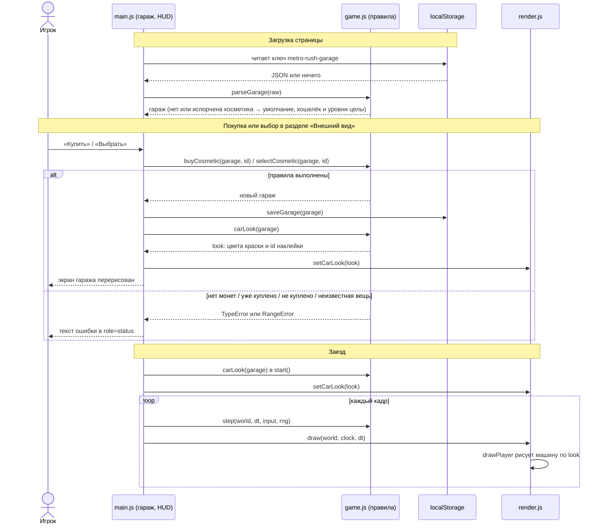

# Design

## Context

Мотивация — в proposal.md («Why»), требования — в `specs/car-cosmetics` и `specs/garage`.

Что важно из текущего кода:
- Гараж — неизменяемое значение `{ coins, levels }` и чистые функции в `game.js`
  (`createGarage`, `parseGarage`, `buyUpgrade`); `main.js` хранит его в
  `localStorage` под ключом `metro-rush-garage` (`loadGarage`/`saveGarage`).
- `parseGarage` строго проверяет `coins` и `levels` и **возвращает только их** —
  любые другие поля сохранения сейчас молча отбрасываются.
- Машина игрока рисуется в `render.js` (`drawPlayer`): цвета кузова и градиент
  задней панели берутся из `PALETTE` (`flame`, `ember`, `sun`, `sunLight`); на задней
  панели есть белый прямоугольник «номер»; после аварии кузов серый.
- `main.js` вызывает `renderer.draw(world, clock, dt)` каждый кадр; рендер ничего не
  знает о гараже.
- Экран гаража строится в `renderGarage()` (`main.js`) из списка улучшений; клики
  обрабатываются делегированием на `#garage-list`, покупка — `buy(id)` в `try/catch`.

## Goals / Non-Goals

**Goals:**
- Правила косметики (каталог, покупка, выбор, разбор сохранения) — чистые функции
  в `game.js` с тестами в Node, как у улучшений.
- Рендер получает только готовое описание внешнего вида (цвета краски и id наклейки),
  не зная о гараже, монетах и покупках.
- Косметика не попадает в `world` и `player` — поэтому симуляция, MCP и все тесты
  логики не меняются.

**Non-Goals:**
- Изменение формы или размеров машины, анимация наклеек.
- Косметика в MCP `simulate_run`.

## Взаимодействие компонентов

Косметика не попадает в `world`: `step` и симуляция о ней не знают, поэтому MCP
и тесты логики не меняются. При ошибке гараж не меняется и не сохраняется.

## Decisions

### 1. Косметика — часть гаража: `garage.cosmetics = { owned, paint, sticker }`
`owned` — массив id купленных вещей (краска «Солнце» всегда в нём), `paint` — id
выбранной краски, `sticker` — id наклейки или `null`.
- *Почему:* одна запись в хранилище, покупки косметики и улучшений тратят один кошелёк
  атомарно.
- *Альтернатива — отдельный ключ `metro-rush-cosmetics`:* отвергнута — кошелёк общий,
  при сбое между двумя записями монеты списались бы без покупки.

### 2. Разбор сохранения по частям
`parseGarage` проверяет кошелёк и уровни как раньше (ошибка → пустой гараж), а
косметику — отдельно: её отсутствие или ошибка → косметика по умолчанию при
сохранённых кошельке и уровнях.
- *Почему:* сохранение из прошлой версии не содержит `cosmetics`; сбрасывать из-за
  этого монеты и уровни игрока недопустимо (`specs/garage`).

### 3. Рендер получает `look`, а не гараж
`renderer.setCarLook({ body, side, top, panel: [3 цвета], sticker })`; `drawPlayer`
берёт цвета из `look` вместо `PALETTE`, наклейку рисует на месте «номера». Цвета
красок — в каталоге `game.js`, рендер их не придумывает.
- *Почему:* рендер остаётся «глупым» и не зависит от правил гаража; при `look`
  по умолчанию картинка совпадает с текущей.
- *Альтернатива — положить косметику в `world.player`:* отвергнута — `world`
  описывает игровое состояние; лишнее поле затронуло бы тесты и MCP.

### 4. Отдельные `buyCosmetic` и `selectCosmetic`
Покупка не выбирает вещь автоматически.
- *Почему:* проще правила и тесты; выбор — отдельное бесплатное действие (`specs/car-cosmetics`).
- *Альтернатива — «купить и надеть» одной кнопкой:* можно добавить в UI позже
  вызовом двух функций подряд, не меняя логику.

## Risks / Trade-offs

- [Изменение `parseGarage` может сломать чтение старых сохранений] → тесты на
  сохранение без `cosmetics` и с повреждённой косметикой; существующие тесты
  `parseGarage` не меняются.
- [Цвета краски плохо читаются на фоне трассы] → палитры красок строятся из токенов
  `docs/DESIGN.md`, обводка `--ink` сохраняется; проверка скриншотами.
- [Наклейка мелкая на дальнем плане] → рисуется на задней панели, которая ближе всего
  к камере.

## Migration Plan

Миграция данных не нужна: при чтении сохранения без `cosmetics` подставляется
умолчание, при следующей записи поле появится. Откат: удалить код косметики — старый
`parseGarage` просто отбросит поле `cosmetics`.
