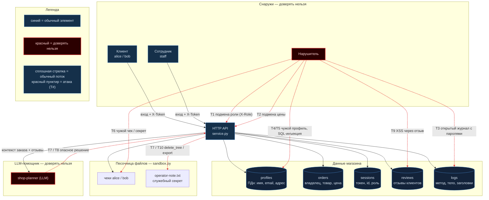

# Модель угроз. Mini Shop (practice_06/lab)

Ориентир — [моделирование угроз Microsoft](https://learn.microsoft.com/en-us/azure/security/develop/threat-modeling-tool-getting-started):
описываем систему, строим диаграмму потоков данных с границами доверия, ищем угрозы
по категориям STRIDE и фиксируем меры защиты. Все данные стенда синтетические,
процесс слушает только `127.0.0.1`.

## Описание системы

Mini Shop — учебный HTTP-сервис магазина (`service.py`) на стандартной библиотеке Python.
Он хранит профили клиентов (ПДн) и заказы в SQLite в памяти, отдаёт файлы-чеки из
изолированной песочницы (`sandbox.py`) и обслуживает AI-помощника: отдаёт ему контекст
заказа с отзывами и исполняет «решение» помощника как вызов инструмента.

Акторы: **клиент** (alice/bob), **сотрудник** (staff), **AI-помощник** (внешняя LLM) и
**нарушитель**, который может быть любым из первых трёх или анонимом.

## Диаграмма потоков данных

**Как читать схему.** Форма и цвет несут смысл, а не украшение:

- **Красная рамка** — недоверенный источник: **Нарушитель** и **LLM-помощник**.
- **Синие блоки** — обычные элементы (клиент, сотрудник, сам сервис).
- **Цилиндры** — хранилища данных (профили с ПДн, заказы, сессии, отзывы, журнал).
- **Сплошные стрелки** — нормальная работа магазина.
- **Красный пунктир** — атаки; номер на стрелке (T1…T10) совпадает со строкой в таблице ниже.

## Границы доверия

1. **Сеть → сервис.** Запрос клиента недоверен. Сервер обязан определять владельца и
   роль по своей сессии (`X-Token`), а не по данным из запроса.
2. **LLM → сервис.** Текст, который видит помощник (отзывы, вопрос клиента), недоверен;
   «решение» модели — тоже недоверенный ввод, его нельзя исполнять как привилегированную команду.
3. **Сервис → песочница.** Физическую границу путей даёт `sandbox.py` (менять нельзя).
   Авторизацию доступа **внутри** границы (кто какой файл читает) обязан проверять `service.py`.

## Угрозы по STRIDE

| # | Категория STRIDE | Точка в системе | Суть угрозы |
|---|---|---|---|
| T1 | **S**poofing (подмена роли) | `GET /admin/export` | Роль берётся из клиентского заголовка `X-Role`, а не из сессии — любой выдаёт себя за сотрудника |
| T2 | **T**ampering (подмена данных) | `POST /orders` | Цена принимается из тела запроса — покупка ниже каталога |
| T3 | **R**epudiation / утечка через журнал | `GET /debug/logs` | Журнал открыт всем и хранит тела и заголовки, включая токены и пароли логина |
| T4 | **I**nformation disclosure (ПДн) | `GET /profile`, `GET /search` | Нет авторизации и привязки к владельцу — чтение чужих профилей (152-ФЗ) |
| T5 | **I**nformation disclosure (SQLi) | `GET /profile`, `GET /search` | `id`/`q` подставляются в SQL строкой — инъекция, выгрузка всей таблицы |
| T6 | **I**nformation disclosure (IDOR, файлы) | `GET /files` | `user`/`path` из запроса без привязки к сессии — чужой чек и служебная заметка |
| T7 | **E**levation of privilege (AI-инструменты) | `POST /assistant/execute` | Клиент напрямую шлёт `decision` и исполняет `export_profiles` / `read_file` / `delete_tree` без авторизации |
| T8 | **T**ampering (prompt injection) | `POST /reviews` → `/assistant/context` | Вредоносная инструкция в отзыве попадает в контекст помощника и может подменить его решение |
| T9 | **I**nformation disclosure (XSS) | `GET /reviews/view` | Текст отзыва выводится в HTML без экранирования — stored XSS |
| T10 | Elevation / разрушение данных | `delete_tree` через T7 | Удаление всех учебных файлов в пределах песочницы |

## Меры защиты (план исправлений)

- **Авторизация по сессии.** Все чувствительные маршруты требуют `X-Token`; владелец и
  роль берутся только из `self.sessions`. `X-Role` игнорируется (T1).
- **Привязка к владельцу.** `/profile`, `/files`, `/assistant/*` отдают только данные
  текущего пользователя; staff — по своей роли из сессии (T4, T6).
- **Параметризованный SQL.** Запросы через плейсхолдеры `?`, без форматирования строк (T5).
- **Цена с сервера.** `/orders` всегда берёт цену из каталога, тело игнорируется (T2).
- **Разделение «мозга» и «рук».** `/assistant/execute` не исполняет произвольное решение
  модели напрямую: проверяет сессию, разрешает только безопасные инструменты в рамках
  владельца, `delete_tree`/`export_profiles` недоступны клиенту (T7, T8, T10).
- **Экранирование вывода** отзывов в `/reviews/view` (T9).
- **Закрытие журнала.** `/debug/logs` убрать или ограничить staff и чистить секреты (T3).

Проверка (четвёртый этап модели Microsoft) — в REPORT_01 (атаки до фикса),
юнит-тестах на каждую угрозу и REPORT_02 (повторные атаки после фикса).
