# Практика 7.1: ассистент код-ревью в n8n

- **Сценарий:** `AI Code Review` на `https://n8n-itmo.cyrweb.ru`, экспорт в [n8n/workflow.json](n8n/workflow.json)
- **Тестовый репозиторий:** https://github.com/karinneyXx1/ai-review-sandbox
- **Тестовый PR:** https://github.com/karinneyXx1/ai-review-sandbox/pull/2 (`feature/discounts` → `main`)
- **Модели:** `openai/gpt-5.2` (основная), `anthropic/claude-sonnet-4.6` (вторая), обе через LiteLLM-прокси курса

## Итоговая схема

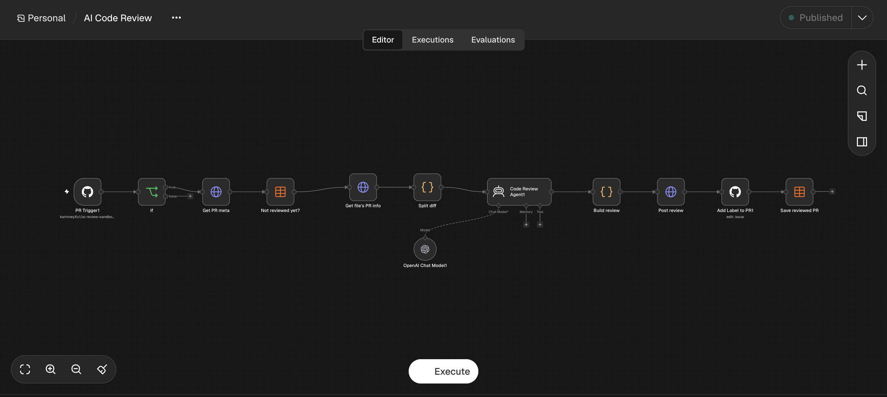

```
PR Trigger1 (pull_request, issue_comment)
  → If (opened ИЛИ /make_ai_review ИЛИ /make_other_ai_review)
  → Get PR meta (GET /pulls/{n}, JSON: номер PR и SHA последнего коммита)
  → Not reviewed yet? (Data Table: нет строки pr_number + head_sha + model)
  → Get file's PR info (тот же PR в формате diff)
  → Split diff (Code: разбивает diff на блоки и нумерует строки)
  → Code Review Agent1 + OpenAI Chat Model1 (модель выбирается по команде)
  → Build review (Code: проверяет JSON модели, оставляет комментарии к строкам из diff)
  → Post review (POST /pulls/{n}/reviews)
  → Add Label to PR1 (метка ReviewedByAI)
  → Save reviewed PR (Data Table: добавить строку)
```

Тестовый PR содержит подложенные ошибки: `eval`, SQL-инъекцию через f-строку, mutable default `used_codes=[]`, голый `except`, O(n²) в `bulk_discount`, недостижимую ветку `platinum`, удаление элементов списка во время итерации.

## Практика на занятии

### Ревью только при открытии PR (версия `шаг 9: только opened`)

Без фильтра сценарий запускался на любое событие PR. Бот сам вешал метку `ReviewedByAI`, это событие `labeled` запускало сценарий ещё раз, и в PR появлялось второе ревью. После триггера добавлена нода If с условием `{{ $json.body.action }} == "opened"`.

| Открытие PR: прошла вся цепочка | Редактирование PR (`edited`): остановка на If, ветка false |
|---|---|
| 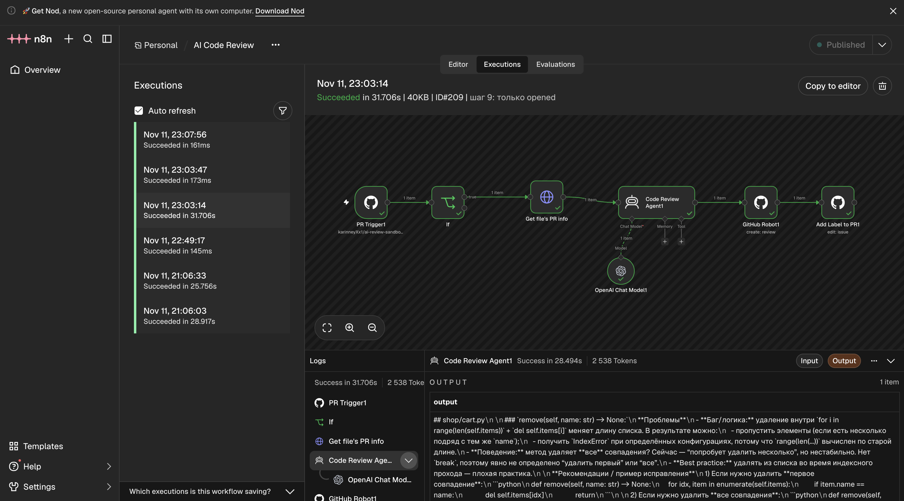 | 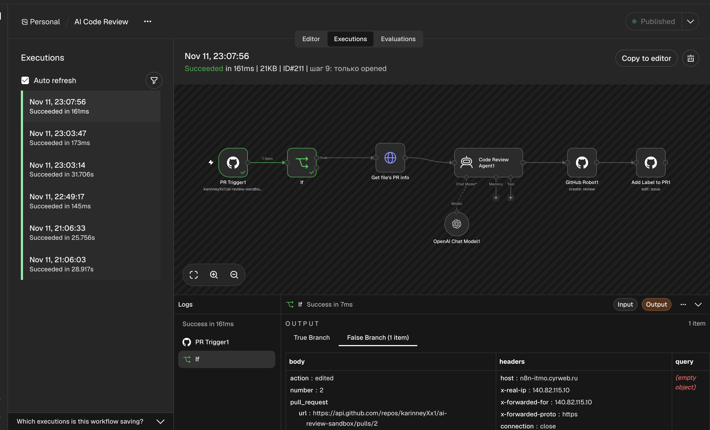 |

### Команда `/make_ai_review` (версия `шаг 10: /make_ai_review`)

- в триггер добавлено событие **Issue Comment**;
- в If добавлено второе условие через **OR**: `{{ $json.body.comment.body }}` contains `/make_ai_review`;
- в событии комментария номер PR лежит в `body.issue.number`, а не в `body.number`, поэтому номер берётся так: `{{ $json.body.number || $json.body.issue.number }}`.

| Запуск от `issue_comment` (`action: created`) | Комментарий и ревью в PR |
|---|---|
| 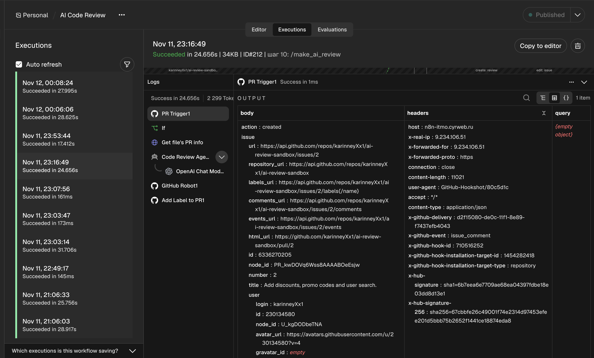 | 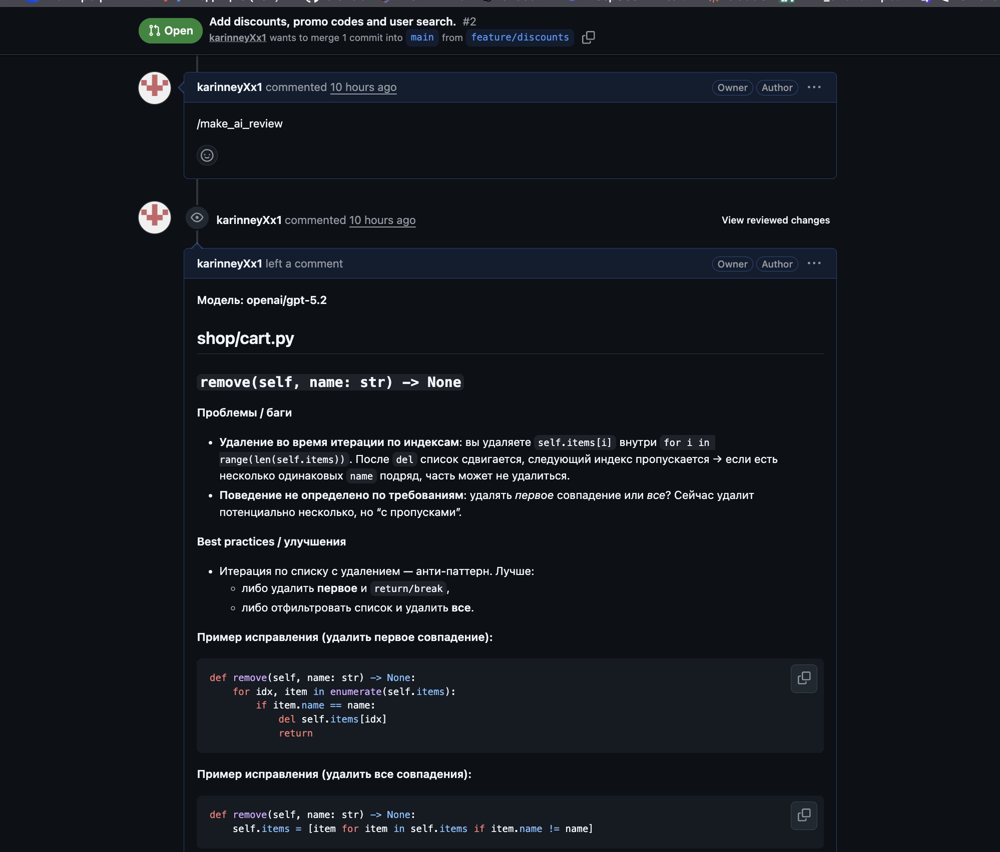 |

## Домашнее задание

### 1. `/make_other_ai_review`: ревью второй моделью (версия `ДЗ 1: /make_other_ai_review`)

Цепочка не дублируется. В If добавлено третье условие, а модель в OpenAI Chat Model1 задаётся формулой:

```
{{ ($('PR Trigger1').first().json.body.comment?.body || '').includes('/make_other_ai_review')
   ? 'anthropic/claude-sonnet-4.6' : 'openai/gpt-5.2' }}
```

Название модели выводится первой строкой ревью, поэтому в PR видно, кто его написал.

| Запуск с моделью Claude | Ревью Claude в PR |
|---|---|
| 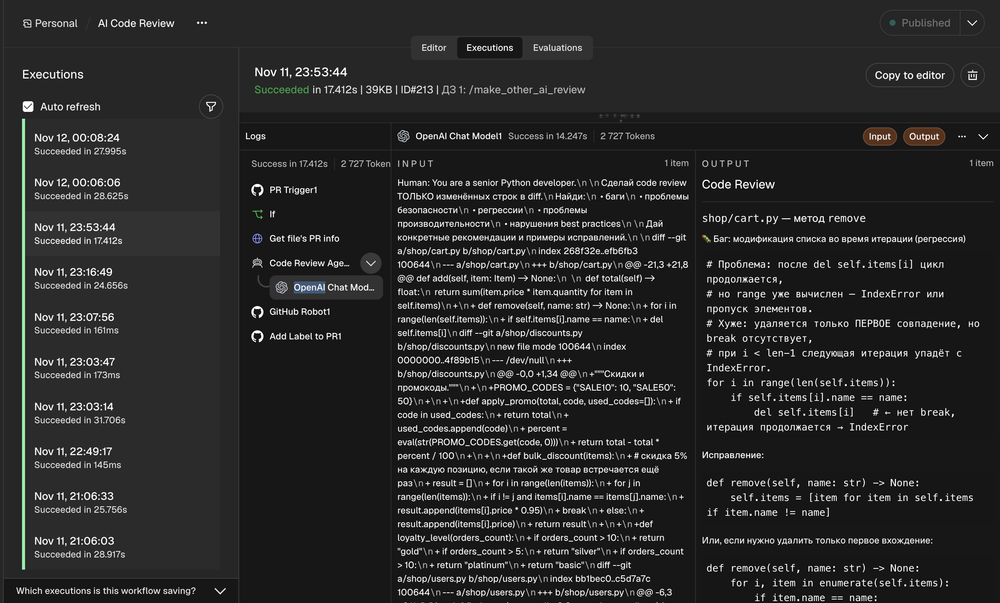 | 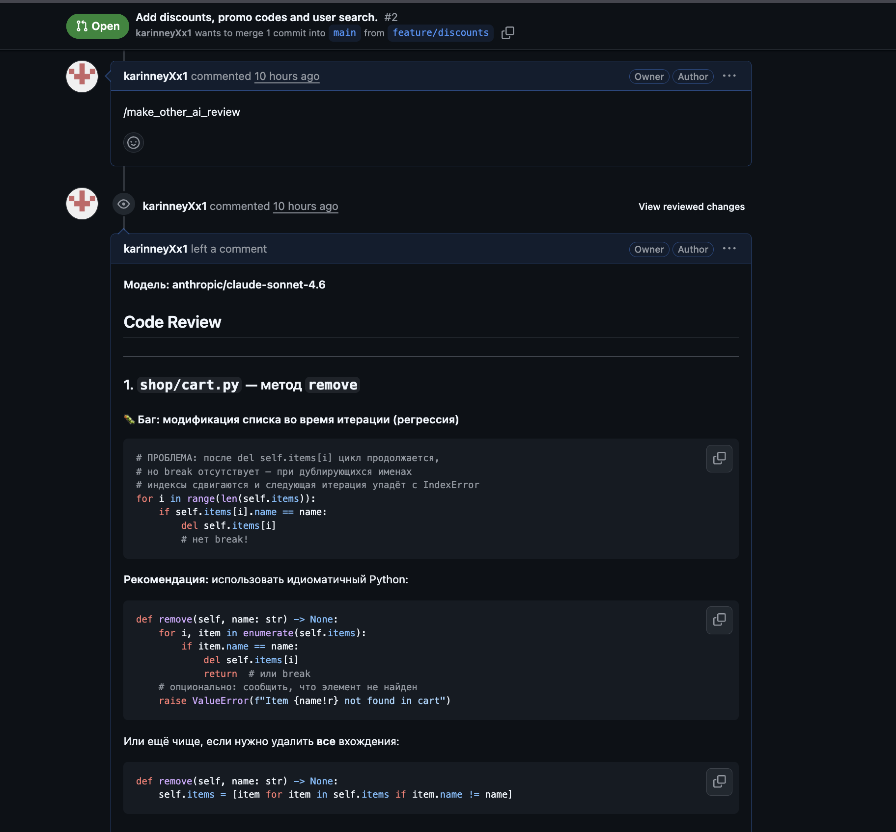 |

**Сравнение на PR #2:**

| | `openai/gpt-5.2` | `anthropic/claude-sonnet-4.6` |
|---|---|---|
| Время ответа модели | ~25–28 с | ~14–18 с |
| Токены | ~2 300–2 700 | ~2 700 |
| Найденные проблемы | все 7 подложенных | все 7 подложенных |
| Стиль | разделы «Проблемы / Best practices / Пример исправления», уточняет требования («удалять первое совпадение или все?») | заголовки по файлам с пометками, сразу несколько вариантов исправления, итоговый список по критичности |

Найденные проблемы совпали. Claude ответил примерно вдвое быстрее и короче. GPT подробнее объясняет и задаёт вопросы о требованиях.

### 2. Data Table: сохраняем PR после ревью (версия `ДЗ 2: Data Table`)

Таблица `reviewed_prs`: `pr_number` (Number), `head_sha` (String), `model` (String), плюс служебные `id`, `createdAt`, `updatedAt`.

- **Get PR meta** запрашивает PR с `Accept: application/vnd.github+json` и получает `number` и `head.sha`.
- **Save reviewed PR** (Data Table → Insert) в конце цепочки записывает номер PR, SHA и модель.

| Запуск с записью в таблицу | Таблица после первого ревью |
|---|---|
| 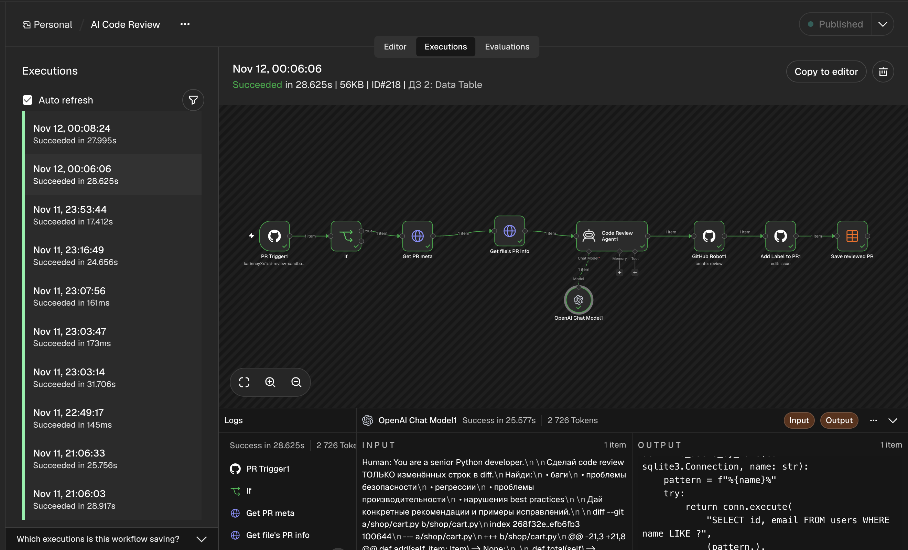 | 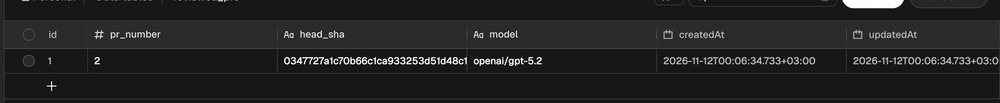 |

### 3. Повторный `/make_ai_review` не запускает ревью (версия `ДЗ 3: без повторов`)

После Get PR meta стоит нода **Not reviewed yet?** (Data Table → If Row Does Not Exist). Её условия, все должны выполниться:
`pr_number = {{ $json.number }}`, `head_sha = {{ $json.head.sha }}`, `model = <формула модели>`.

Если строка есть, нода ничего не передаёт дальше: запуск заканчивается за ~0,8 с, модель не вызывается.

| Повторный `/make_ai_review` остановился на проверке | В PR под повторной командой нет нового ревью |
|---|---|
| 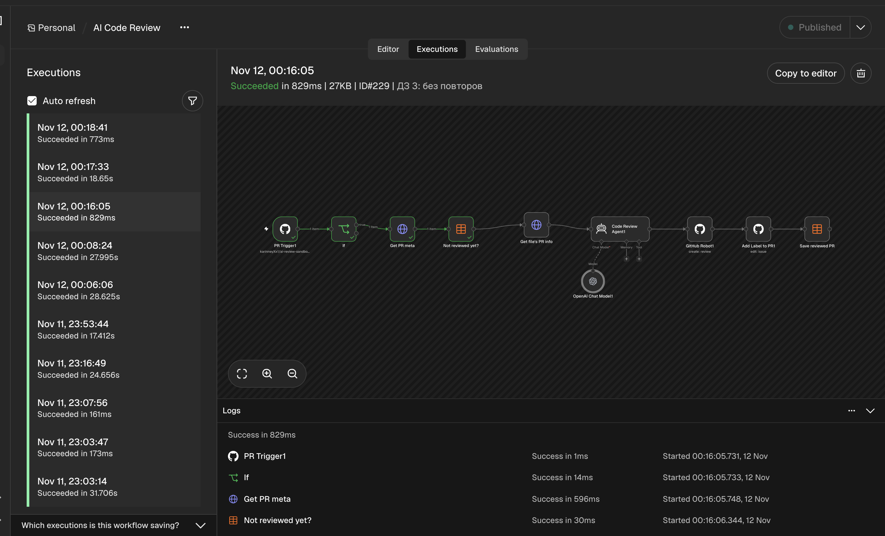 | 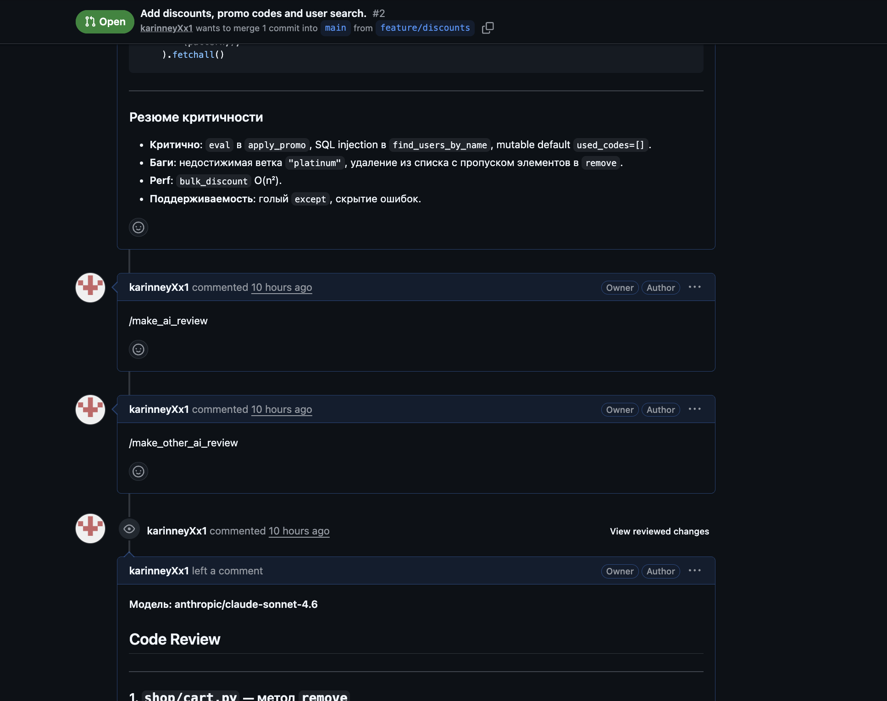 |

Таблица после тестов: одна строка на каждую пару «коммит + модель», дублей нет.

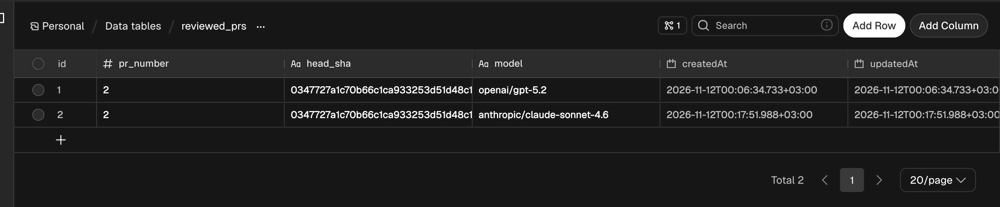

**Почему хранится SHA, а не только номер PR.** Если хранить только номер, после нового коммита повторное ревью стало бы невозможным. С SHA повтор блокируется только для того же кода. Проверка: в ветку добавлен коммит `5acaab3` (исправление `Cart.remove`), после него `/make_ai_review` снова сделал ревью, и в таблице появилась строка с новым SHA.

| Ревью после нового коммита | Строка с новым SHA |
|---|---|
| 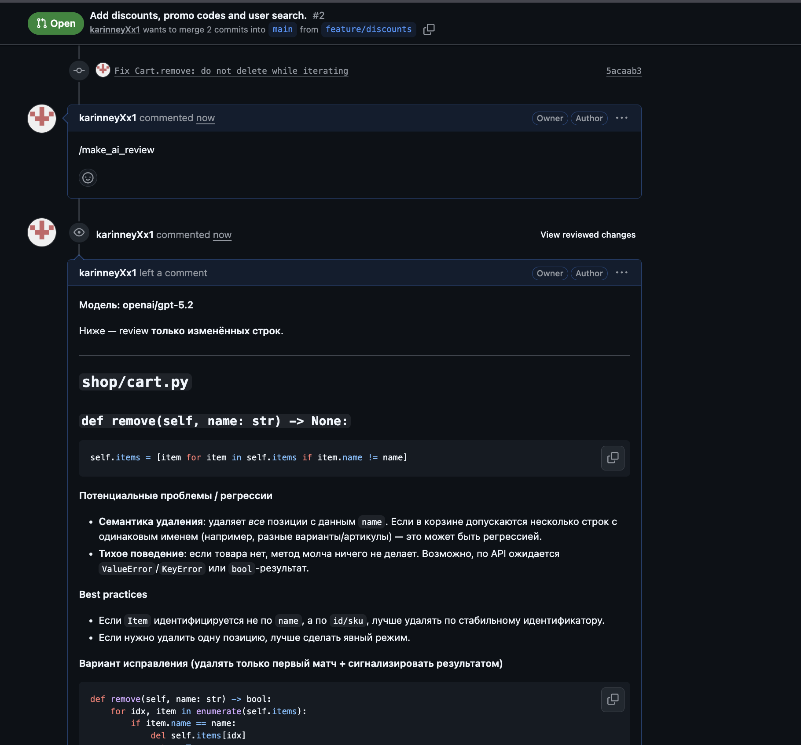 | 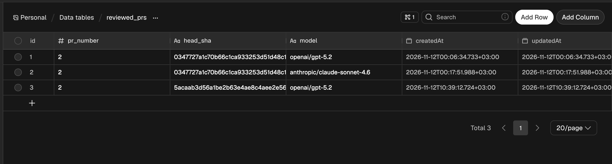 |

Модель тоже входит в ключ, поэтому `/make_ai_review` и `/make_other_ai_review` не блокируют друг друга: каждая модель ревьюит каждый коммит один раз.

### 4. ⭐ Точечные комментарии к строкам diff (версия `ДЗ 4: точечные комментарии`)

Код нод лежит в [n8n/split_diff.js](n8n/split_diff.js) и [n8n/build_review.js](n8n/build_review.js), промпт агента — в [n8n/agent_prompt.txt](n8n/agent_prompt.txt).

**Как diff режется на блоки и как привязываются строки:**

1. **Split diff** идёт по diff построчно:
   - `diff --git` / `+++ b/<путь>` — начало нового файла, запоминается путь;
   - `@@ -21,3 +21,6 @@` — начало блока (hunk), из `+21` берётся номер первой строки в новой версии файла;
   - строки `+` (добавлены) и строки контекста получают метку `L<номер>`, и номер увеличивается;
   - строки `-` (удалены) номер не увеличивают: в новой версии файла их нет;
   - номера строк `+` собираются в `valid[путь]`: только к ним можно оставить комментарий.

   Пример того, что видит модель:
   ```
   +++ b/shop/users.py
   @@ -6,3 +6,11 @@ import sqlite3
   L11 +def find_users_by_name(conn: sqlite3.Connection, name: str):
   L12 +    query = f"SELECT id, email FROM users WHERE name LIKE '%{name}%'"
   ```
2. **Агент** возвращает JSON: `{"summary": "...", "comments": [{"path": "shop/users.py", "line": 12, "body": "..."}]}`.
3. **Build review** разбирает JSON (убирает обёртку ```` ```json ````, если она есть) и сверяет каждую пару `path + line` с `valid`. Комментарий к строке не из diff GitHub бы отклонил вместе со всем ревью, поэтому такие замечания переносятся в общий текст. Затем нода собирает тело запроса: `commit_id` = SHA, `event: "COMMENT"`, `comments: [{path, line, side: "RIGHT", body}]`.
4. **Post review** отправляет `POST /repos/{owner}/{repo}/pulls/{n}/reviews`. Получается одно ревью: резюме сверху, замечания у строк кода.

Результат: модель вернула 7 замечаний, все 7 привязались к строкам (`inline_count: 7`, `skipped_count: 0`).

| Запуск, вывод Build review | Комментарии у строк в PR |
|---|---|
| 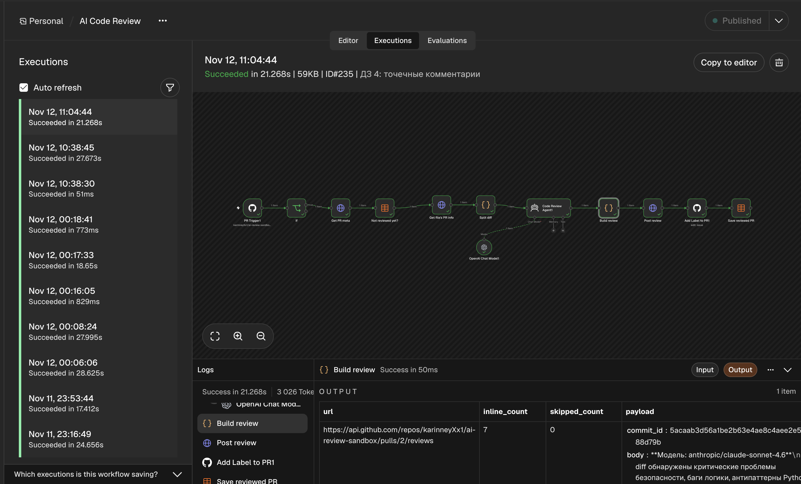 | 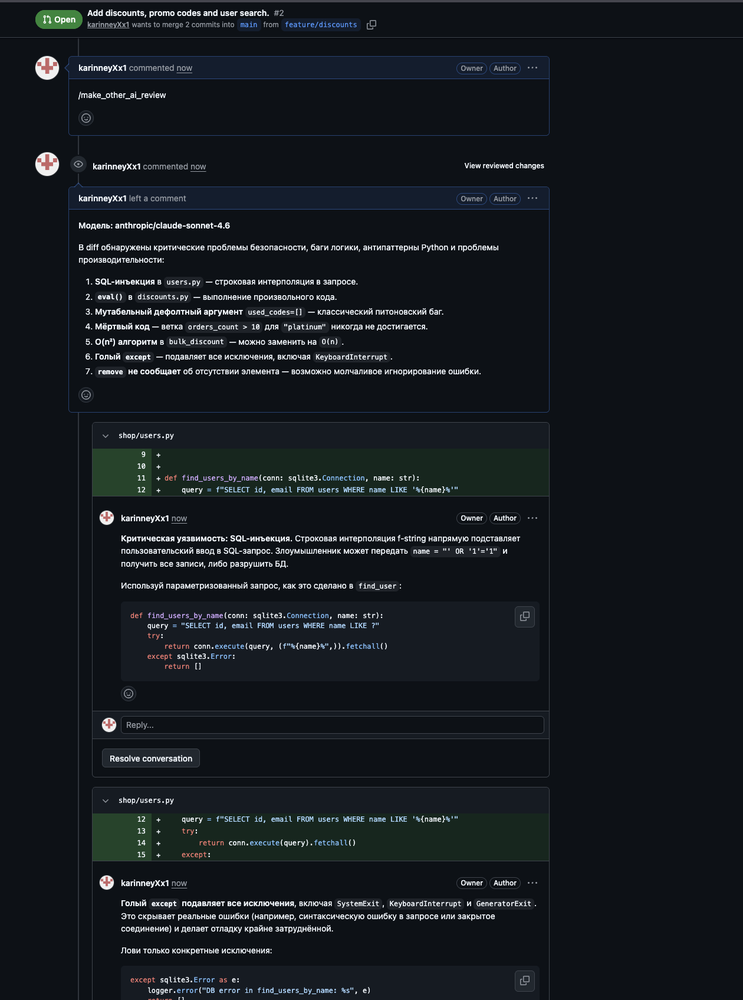 |

## Ограничения

- комментарий возможен только к добавленным строкам;
- если модель вернёт не JSON, всё ревью уйдёт общим комментарием без привязки к строкам;
- команды в комментариях к обычным issue (не PR) тоже пройдут If, а дальше упадут на запросе к `/pulls/{n}`;
- доступ к командам не ограничен: `/make_ai_review` может написать любой, у кого есть право комментировать.
