# Практика 7.2: классификация Issues и еженедельная статистика

- **Репозиторий с Issues:** https://github.com/karinneyXx1/tutor-hub/issues?q=is%3Aissue — сервис «Код-репетитор» (FastAPI + SQLite), Issues всех типов, включая расплывчатый [#11 «Иногда не работает»](https://github.com/karinneyXx1/tutor-hub/issues/11) с меткой `needs-triage`
- **n8n:** `https://n8n-itmo.cyrweb.ru`, модель `openai/gpt-5.2` через LiteLLM-прокси
- **Экспорт сценариев:**

| Сценарий | Файл |
|---|---|
| WF1 Issues triage | [n8n/wf1_issues_triage.json](n8n/wf1_issues_triage.json) |
| Issue classifier (sub) | [n8n/issue_classifier_sub.json](n8n/issue_classifier_sub.json) |
| WF Weekly stats | [n8n/weekly_stats.json](n8n/weekly_stats.json) (адрес получателя заменён на заглушку) |

Код Code-нод сценария статистики дополнительно вынесен в [n8n/code/](n8n/code/).

## Часть 1. Workflow 1: разбор Issues

```
Github Trigger (issues)
  → If (action = opened ИЛИ reopened)
  → New issue? (Data Table processed_issues: такого issue_id ещё нет)
  → Remember issue (записать issue_id, номер, автора, дату)
  ├→ Classify issue (sub-workflow) → Switch
  │     ├ bug          → метка bug + комментарий
  │     ├ task         → метка task + комментарий
  │     ├ feature      → метка feature + комментарий
  │     ├ spam         → метка spam + закрыть Issue
  │     └ needs-triage → только метка, без комментария
  └→ First-time? (author_association = NONE / FIRST_TIMER / FIRST_TIME_CONTRIBUTOR)
        → метка first-time-contributor + приветствие со ссылкой на CONTRIBUTING.md
```

### 1. Классификация и метки

Классификатор — Basic LLM Chain со Structured Output Parser. Схема ответа:

```json
{ "type": "bug | task | feature | spam | unknown", "confidence": 0..1 }
```

Парсер сам добавляет в промпт описание формата, на выходе ноды готовый объект без `JSON.parse`. Промпт описывает проект и типы и содержит по одному примеру на каждый тип (few-shot).

Switch выбирает ветку формулой `{{ $json.confidence >= 0.8 ? $json.type : 'unknown' }}`, сравнивая её с `bug` / `task` / `feature`. Для `spam` порог выше, 0.95: эта ветка закрывает Issue, и ошибка в ней дороже. Всё, что не подошло ни под одно правило, уходит в выход `needs-triage` (Fallback Output).

| Классификатор: `bug`, 0.9 | Issues в репозитории с метками |
|---|---|
| 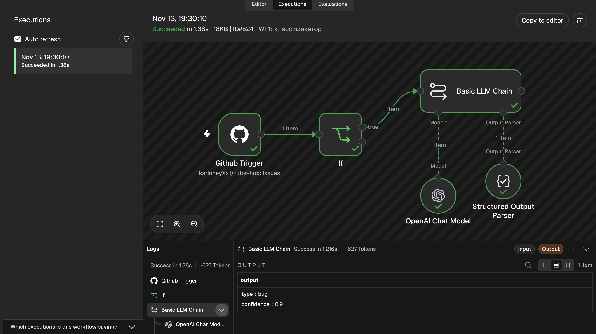 | 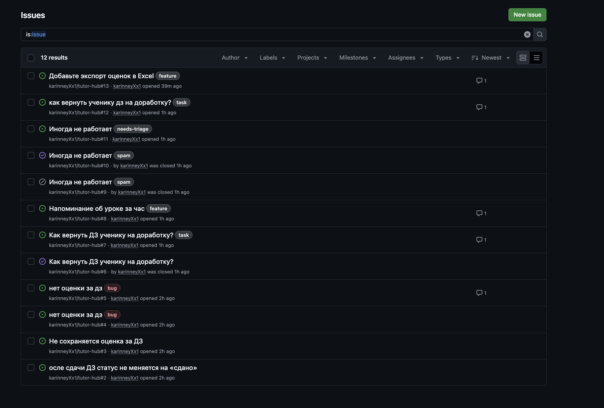 |

| Метка `bug` и комментарий-шаблон | `needs-triage`: метка есть, комментария нет |
|---|---|
| 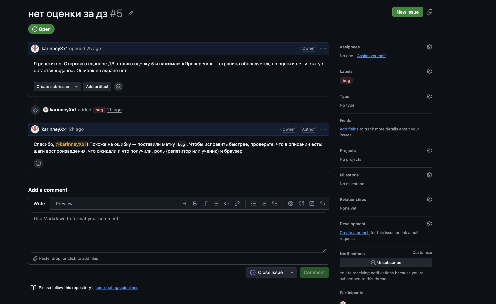 | 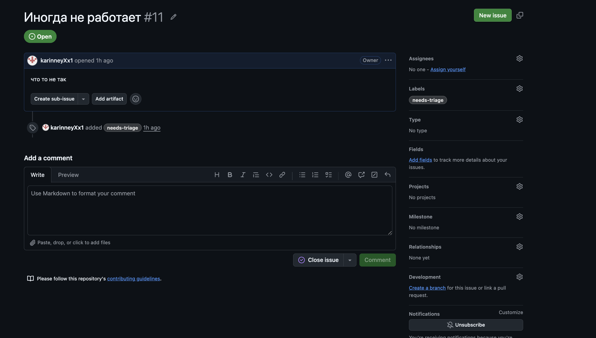 |

### 2. Эскалация в `needs-triage`

Issue #11 «Иногда не работает / что то не так» получил `type: unknown`, `confidence: 0.3` и ушёл в ветку `needs-triage`: метка ставится, комментарий не публикуется.

Первая версия промпта относила такие Issues к `spam` (#9, #10 закрыты как спам). Исправление: в промпт добавлено правило «жалоба на неработающий сервис — это не спам, даже без деталей» и few-shot примеры каждого типа, а для `spam` поднят порог уверенности.

### 3. Классификатор в Sub-workflow

Сценарий `Issue classifier (sub)`: Execute Workflow Trigger `When called by WF1` принимает `title` и `body` → Basic LLM Chain + модель + парсер → Set `Return type and confidence` возвращает `type` и `confidence`.

В WF1 вместо классификатора стоит нода Execute Workflow `Classify issue (sub-workflow)`, которая передаёт `title` и `body` из события GitHub. Switch читает `type` и `confidence` из её ответа. Поведение для всех типов не изменилось: после рефакторинга Issues снова получили те же метки.

| WF1: вызов Sub-workflow, ответ `feature`, 0.94 | Issue после рефакторинга: `task` и комментарий |
|---|---|
| 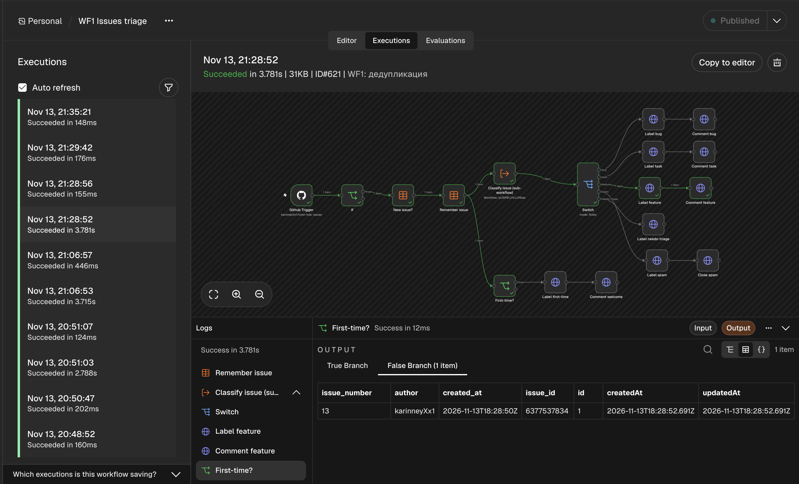 | 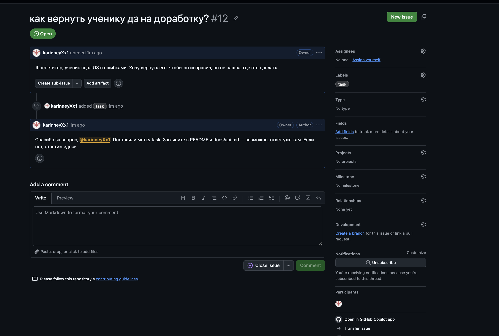 |

| Sub-workflow получает `title` и `body` | Sub-workflow возвращает `type` и `confidence` |
|---|---|
| 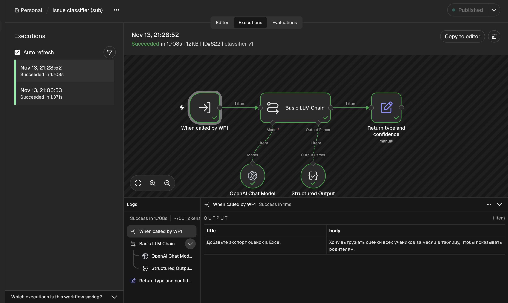 | 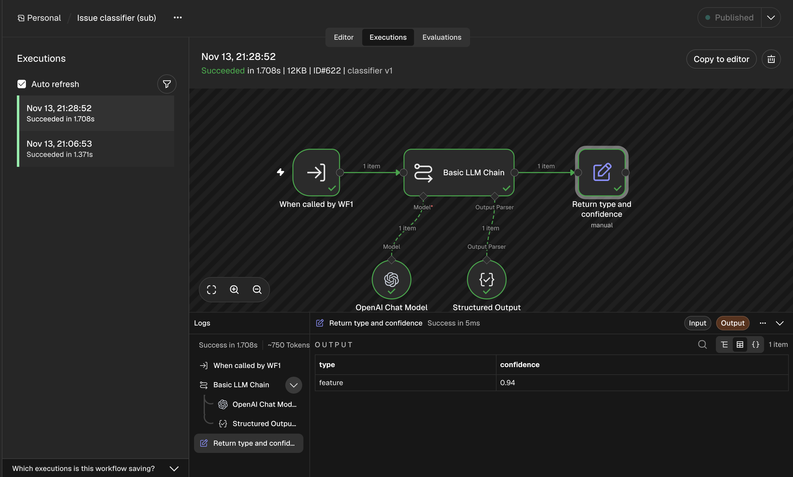 |

### Дополнительно: first-time-contributor и дедупликация

**first-time-contributor.** Параллельная ветка проверяет `author_association`. Для новичка ставится метка `first-time-contributor` и публикуется приветствие со ссылкой на `CONTRIBUTING.md`. Issues владельца репозитория (`OWNER`) уходят в ветку false.

**Дедупликация.** Состояние хранится в Data Table `processed_issues` (`issue_id`, `issue_number`, `author`, `created_at`). WF1 реагирует на `opened` и `reopened`. Нода `New issue?` (If Row Does Not Exist) ищет `issue_id`: если Issue уже обработан, сценарий останавливается. Проверка: Issue #13 открыт → обработан и записан; закрыт → событие `closed` отсечено If; открыт снова → остановка на `New issue?`, второго комментария нет.

| Новый Issue: запись в таблицу и классификация | Таблица `processed_issues` |
|---|---|
| 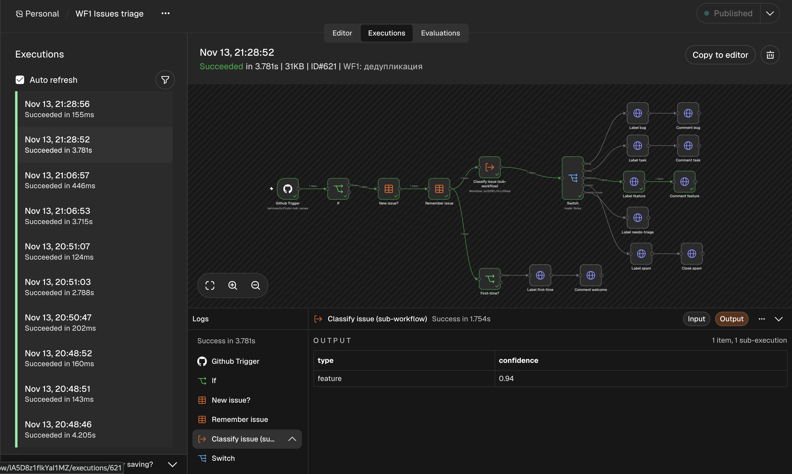 | 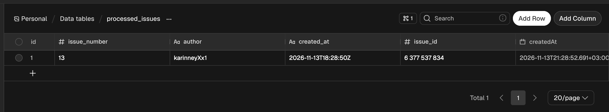 |

| `closed` отсечено If | `reopened` остановлено на `New issue?` (0 items) |
|---|---|
| 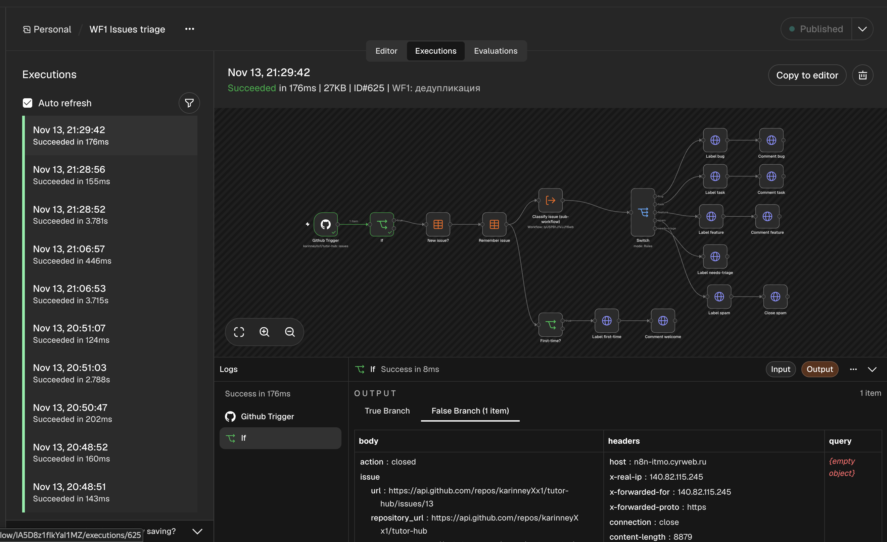 | 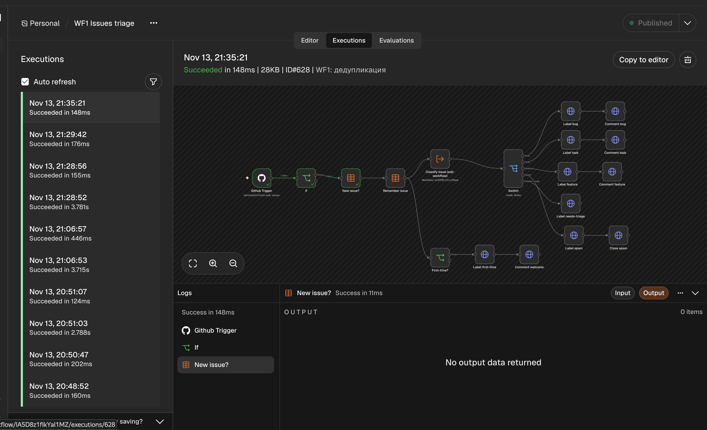 |

## Часть 2. Еженедельная статистика → Gmail

```
Every Monday 9:00 (cron 0 9 * * MON, Europe/Moscow)
  → Week range (последние 7 дней)
  → Issues opened → Issues closed → PRs opened → PRs merged   (GitHub Search API)
  → Group stats (по типу и по автору)
  → Load history → Compute delta → Save week   (Data Table weekly_stats)
  → AI comment (Basic LLM Chain) → Build email (HTML) → Send report (Gmail)
```

### 4. Cron и запросы к GitHub API

Четыре запроса к `GET /search/issues` за неделю (`W` — дата начала недели):

| Нода | Запрос |
|---|---|
| Issues opened | `repo:karinneyXx1/tutor-hub is:issue created:>=W` |
| Issues closed | `repo:karinneyXx1/tutor-hub is:issue closed:>=W` |
| PRs opened | `repo:karinneyXx1/tutor-hub is:pr created:>=W` |
| PRs merged | `repo:karinneyXx1/tutor-hub is:pr is:merged merged:>=W` |

Для проверки сценарий запускался вручную; расписание настроено и сценарий опубликован.

| Cron-триггер `0 9 * * MON` | Запуск: все ноды выполнены, письмо отправлено |
|---|---|
| 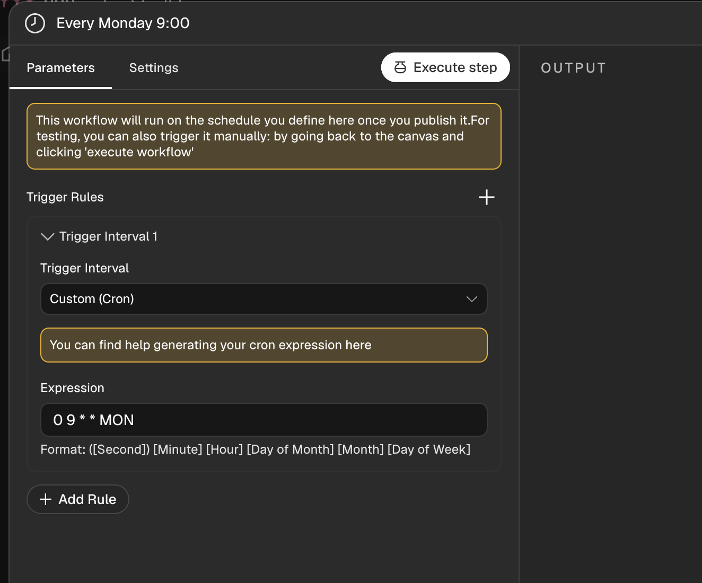 | 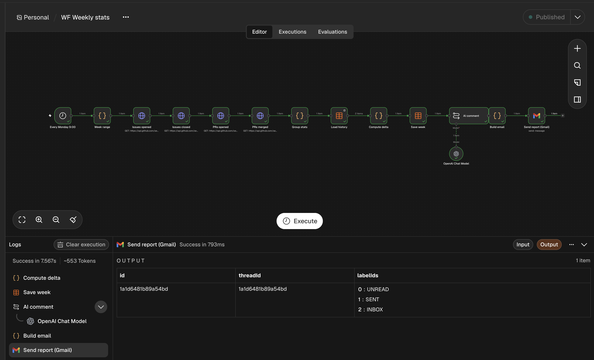 |

### 5. Группировка ([group_stats.js](n8n/code/group_stats.js))

- **по типу:** тип Issue определяется по метке, которую поставил WF1 (`bug`, `task`, `feature`, `needs-triage`, `spam`; без метки — `no-label`);
- **по автору:** для каждого логина число открытых за неделю Issues и PR;
- **итоги:** `total_count` четырёх запросов.

### 6. Письмо через Gmail

[build_email.js](n8n/code/build_email.js) собирает HTML с тремя таблицами (активность, Issues по типам, авторы) и блоком AI-комментария. Нода Gmail отправляет его через OAuth2.

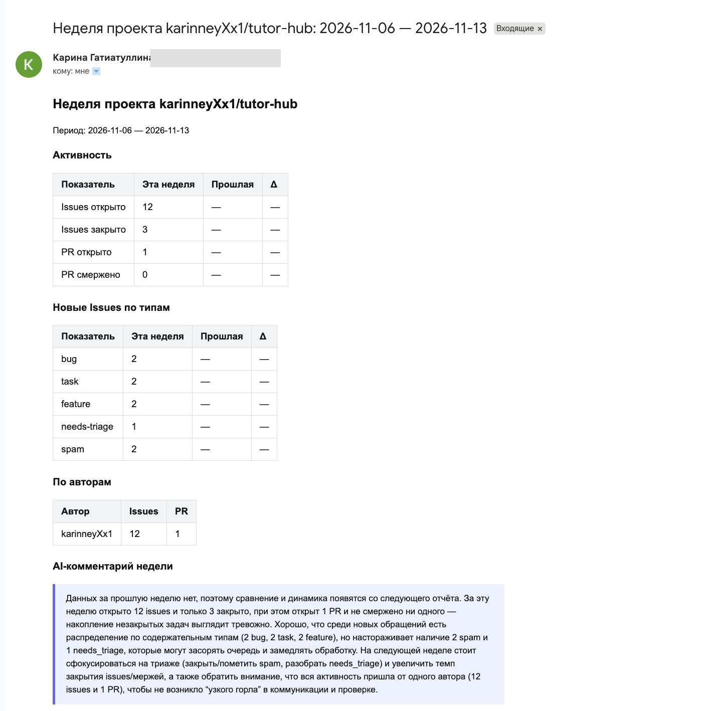

## Задание со звёздочкой

### 7. История в Data Table

После подсчёта нода `Save week` записывает неделю в `weekly_stats`: `week_start`, четыре итоговых числа, число Issues каждого типа, авторы (JSON). Вторая неделя (`2026-10-30`) добавлена тестовой записью.

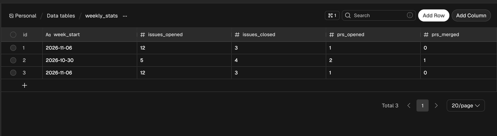

### 8. Δ к прошлой неделе ([compute_delta.js](n8n/code/compute_delta.js))

`Load history` читает все строки таблицы. Прошлая неделя — самая поздняя строка с `week_start` раньше текущей. Δ = значение этой недели минус значение прошлой, для каждого показателя. В письме Δ выводится со стрелкой и цветом; если прошлой недели нет, стоит «—».

### 9. AI-комментарий недели

Basic LLM Chain `AI comment` получает текущие значения, значения прошлой недели, Δ и разбивку по авторам. Он пишет 3–4 предложения: что изменилось, что тревожно, на что обратить внимание. Если истории нет, сообщает, что сравнение появится со следующего отчёта (первое письмо).

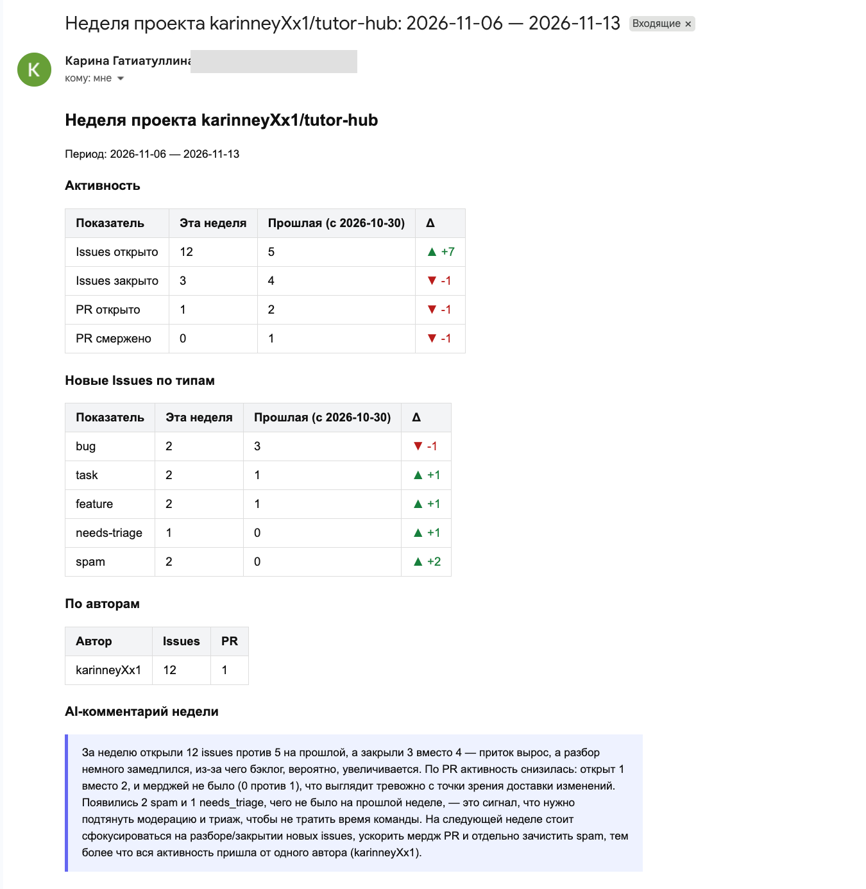
